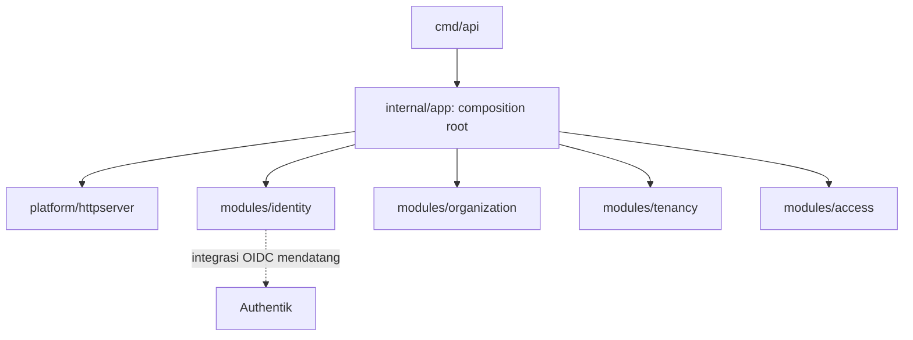

# Arsitektur modular monolith

TenantLedger menggunakan satu proses Go dengan modul bisnis terpisah. Authentik
tetap menjadi identity provider eksternal. Struktur ini menyiapkan pengembangan
tenant context, IAM, RBAC, organisasi, membership, dan pengujian isolasi tenant.
Saat ini hanya wiring aplikasi dan health endpoint yang berjalan. Modul tenancy
memiliki migration dan query sqlc awal; modul lain masih scaffold. Autentikasi,
otorisasi, serta koneksi database pada runtime API belum diimplementasikan.



Panah ke modul menunjukkan arah wiring saat fiturnya diimplementasikan.
`internal/app` saat ini baru membuat Gin router; modul belum mendaftarkan route.
Router berada di `internal/platform/httpserver` dan dikembalikan sebagai
`http.Handler` oleh composition root. `internal/app` mengelola dependency dan
lifecycle `http.Server` melalui `samber/do/v2`; `cmd/api` membaca konfigurasi
dan meneruskan context signal proses ke aplikasi. Ketika fitur modul dibuat, facade dapat menerima
`gin.IRoutes` atau `*gin.RouterGroup` untuk mendaftarkan handler dari
`internal/transport/http`. Domain dan application tetap bebas dari dependency Gin.

## Isi setiap modul

Contoh untuk identity; struktur yang sama tersedia pada modul lain:

```text
internal/modules/identity/
  doc.go                       deklarasi paket facade dan tanggung jawabnya
  internal/
    domain/                    entity, value object, aturan domain
    application/               use case dan interface dependency yang dibutuhkan
    infrastructure/            implementasi adapter OIDC, session store, database
    transport/http/            handler dan DTO HTTP milik modul
```

Folder layer dilacak lewat `.gitkeep` sampai ada implementasi. Tambahkan facade
seperti `module.go` pada root modul ketika perlu merangkai use case dan adapter
serta mengekspos fungsi seperti `RegisterRoutes`. Jangan membuat handler atau
service kosong yang seolah-olah sudah menyediakan login.

`domain` memakai standard library dan aturan bisnis modul sendiri.
`application` memakai domain dan mendefinisikan interface kecil sesuai kebutuhan
use case. Adapter infrastructure dan transport bergantung ke dalam, ke interface
dan use case tersebut. Facade merangkai semuanya; `internal/app` merangkai facade
antar modul melalui injector privat. `cmd/api` menangani konfigurasi dan signal proses.
Injector tidak diteruskan ke use case atau repository; dependency modul tetap
diberikan secara eksplisit melalui constructor. Lihat [pola library Samber](samber.md).

## Kepemilikan modul

| Modul | Tanggung jawab | Contoh kode mendatang |
| --- | --- | --- |
| `identity` | Referensi user `(issuer, subject)`, login OIDC, session | callback handler, Authentik adapter |
| `organization` | Organisasi, undangan, membership user | join organization, cek membership aktif |
| `tenancy` | Lifecycle tenant dan resolusi konteks tenant aktif | tenant resolver, aktivasi tenant |
| `access` | Role, permission, role assignment, keputusan akses per tenant | permission check, grant role |

Untuk struktur awal ini, organisasi dan tenant diperlakukan sebagai konsep
berbeda: organisasi mengelola keanggotaan, tenant menentukan batas isolasi data.
Relasi keduanya akan ditetapkan saat model domain diimplementasikan.
Verifikasi membership harus melalui kontrak organisasi; `access` tidak membaca
tabel atau repository organisasi secara langsung.

## Aturan dependency

- Modul lain dan `internal/app` hanya mengimpor facade root sebuah modul.
  Folder `internal` di dalam modul membuat Go menolak import langsung ke
  implementasinya dari luar pohon modul tersebut.
- Komunikasi antar modul dilakukan dengan pemanggilan Go dalam proses. Definisikan
  interface kecil pada sisi pemakai, lalu injeksikan implementasi facade melalui
  `internal/app`. Hindari cyclic import dan dependency ke struct repository modul lain.
- `internal/platform` hanya untuk kebutuhan teknis bersama seperti HTTP, koneksi
  database, dan logging; platform tidak mengimpor modul bisnis atau menyimpan
  entity tenant, user, role, maupun membership.
- Setiap modul memiliki tabel, query, dan migrasinya sendiri. Saat persistence
  ditambahkan, tempatkan di `internal/infrastructure/postgres/` milik modul.
  Satu database bisnis boleh dipakai bersama dengan ownership tabel/schema
  yang jelas; database Authentik tetap terpisah.
- Test unit diletakkan bersama package yang diuji (`*_test.go`); test integrasi
  modul diletakkan di modul pemiliknya. Pengujian alur lintas modul dan tenant
  isolation dapat ditempatkan pada `internal/app` saat fiturnya tersedia.

## Keamanan dan kegagalan

Endpoint bisnis mendatang wajib memvalidasi identitas, membership, dan permission.
Tenant ID dari request bukan bukti otorisasi. Query data bisnis harus selalu
dibatasi tenant yang sudah diverifikasi. Kegagalan identity provider atau
membership lookup harus menolak akses, bukan melewati pemeriksaan.

`/healthz` hanya menunjukkan proses hidup dan tetap independen dari Authentik.
Tambahkan readiness terpisah ketika API mulai membutuhkan database dan OIDC.
Satu proses berarti kegagalan proses atau deployment berdampak pada semua modul;
timeout pada adapter eksternal diperlukan agar kegagalan Authentik tidak
menahan seluruh request. Struktur ini belum membutuhkan broker, RPC internal,
atau deployment terpisah per modul.

Keputusan dan trade-off dicatat di
[ADR-0001](adr/0001-modular-monolith.md).
